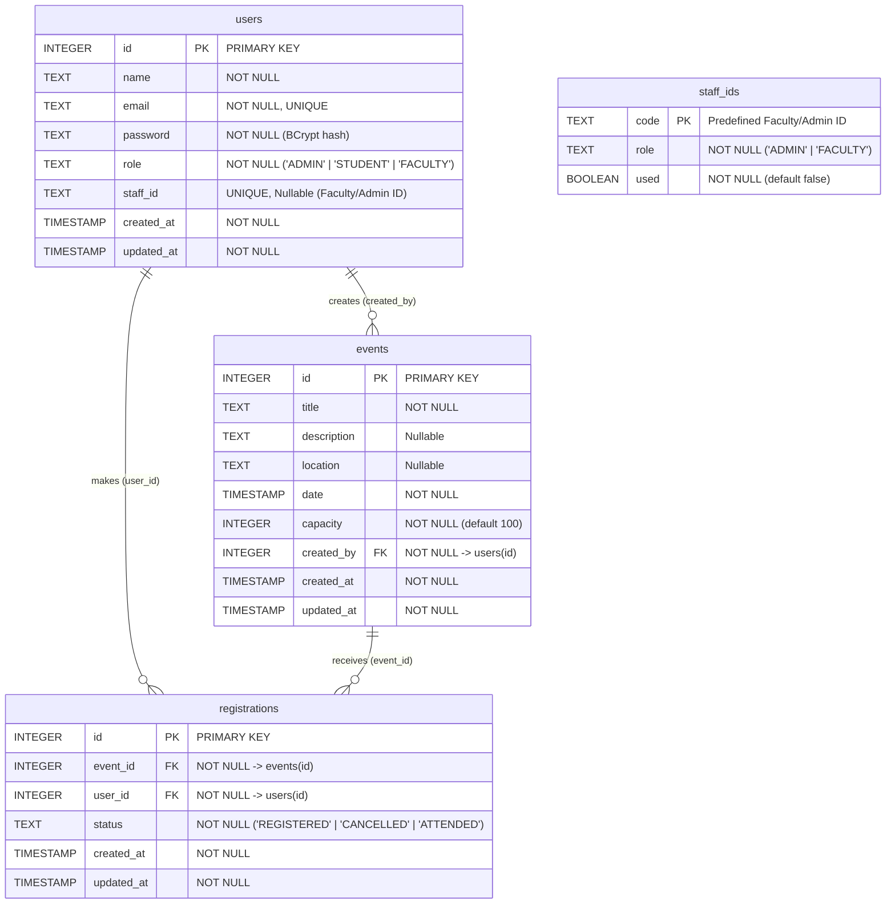

# Entity-Relationship (ER) Diagram & Database Schema

## 1. ER Diagram



## 2. ASCII Entity-Relationship Overview

```text
+-------------------+       1     creates     N       +-------------------+
|       users       |---------------------------------|       events      |
+-------------------+                                 +-------------------+
| PK id             |                                 | PK id             |
|    name           |                                 |    title          |
|    email (UNIQUE) |                                 |    description    |
|    password       |                                 |    location       |
|    role           |                                 |    date           |
|    created_at     |                                 |    capacity       |
|    updated_at     |                                 | FK created_by     |
+-------------------+                                 |    created_at     |
         |                                            |    updated_at     |
         | 1                                          +-------------------+
         |                                                      |
         | makes                                       receives |
         |                                                      |
         | N                                                  N |
         +-----------------> +-------------------+ <------------+
                             |   registrations   |
                             +-------------------+
                             | PK id             |
                             | FK event_id       |
                             | FK user_id        |
                             |    status         |
                             |    created_at     |
                             |    updated_at     |
                             +-------------------+
```

## 3. Table Relationships & Constraints

1. **users -> events (`1 : N`)**
   - Foreign key `events.created_by` references `users.id`.
   - Every event has an organizing `admin` user.
2. **users -> registrations (`1 : N`)**
   - Foreign key `registrations.user_id` references `users.id`.
   - A student can register for multiple events; duplicate active (`REGISTERED`) registrations for the same `(event_id, user_id)` pair are prevented at the service layer (`409 Conflict`).
3. **events -> registrations (`1 : N`)**
   - Foreign key `registrations.event_id` references `events.id`.
   - Active registration count (`status = 'REGISTERED'`) is enforced against `events.capacity` before inserting a new registration.
   - Deleting an event deletes its associated registrations cleanly in a single database transaction.

## 4. SQLite Storage & Automatic Initialization

- **Database file:** `database/database.sqlite` (configured via relative path `../database/database.sqlite` in `backend-java/src/main/resources/application.properties` and resolved by `CollegeEventApplication`).
- **Driver & Dialect:** `org.xerial:sqlite-jdbc` + `org.hibernate.community.dialect.SQLiteDialect`.
- **DDL Management:** `spring.jpa.hibernate.ddl-auto=update` automatically creates tables on first run if `database/database.sqlite` does not exist and preserves existing records across restarts.
- **SQLite Pragmas:** `PRAGMA foreign_keys = ON; PRAGMA busy_timeout = 5000;` with Hikari pool size `1` to prevent write lock contention.
